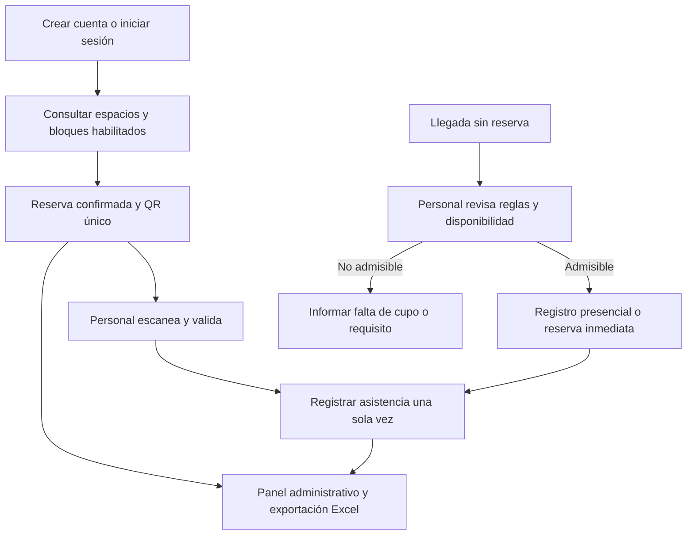

# Desarrollo de la propuesta — 15 de octubre de 2026

## Hub Conecta — cuentas, reservas y asistencia

Plataforma de cuentas, reservas y registro de asistencia del Hub Providencia.

**Equipo:** Ingenia 5. Xiomara Quiroz, Michelle Jara, Felipe Cornejo, Juan Millapán y Joaquín Aguilera.

**Curso:** Proyecto Capstone Intermedio. **Docente:** Isabel Alvarado Strange. **Actualización:** 25 de octubre de 2026.

Esta versión sustituye el diseño de QR personal reutilizable y autoatención por una plataforma en la que cada persona crea una cuenta, cada reserva confirmada tiene un QR propio y el personal lo lee para registrar asistencia. El panel muestra reservas y asistencias por separado y permite exportar registros a Excel. Se conserva el problema de caracterización y recurrencia; cambian el flujo operativo y el alcance técnico.

Los permisos del Hub siguen pendientes. Los componentes, metas y costos siguientes son planificación preliminar, no funciones implementadas ni resultados comprobados.

## 1 Problema y necesidad que aborda

### 1.1 Problema específico

La bitácora del 24/09 describe registros repetidos y dificultades para consolidar información de las personas que visitan el Hub. La propuesta aborda la vinculación entre perfil, reserva y asistencia efectiva: una reserva por sí sola no demuestra que la persona haya concurrido.

Hub Conecta busca reutilizar el perfil de la cuenta, organizar reservas de los espacios habilitados y registrar la llegada mediante validación del QR por personal autorizado. También permite registrar visitas espontáneas admitidas, sin confundirlas con reservas anticipadas.

### 1.2 Personas afectadas y evidencia

Las personas usuarias requieren un proceso claro para reservar y presentarse. El personal necesita consultar disponibilidad y validar llegadas. La gestión necesita distinguir demanda programada, asistencia y recurrencia.

La evidencia de terreno consignada en la bitácora sustenta la brecha de integración. La creación de cuentas y la reserva integrada son decisiones actuales del equipo, aún por validar con la contraparte. No se afirma que el Hub carezca actualmente de todos los mecanismos de reserva.

La consulta municipal realizada el 25/10/2026 permite delimitar el catálogo:

| Espacio o servicio | Información oficial consultada | Tratamiento en la propuesta |
| --- | --- | --- |
| Cowork general | El portal municipal lo describe como libre y sin reserva previa. | No se convertirá en un espacio de reserva obligatoria. Sus visitas espontáneas podrán registrarse si el Hub autoriza ese alcance. |
| Cowork textil | La noticia municipal del 05/01/2024 señala uso de equipamiento previa reserva. | Candidato al catálogo reservable; vigencia, recursos y reglas concretas se confirmarán con el Hub. |
| LAB881 | La página de Innovación informa agenda de máquinas y capacitación obligatoria para utilizarlas. | Candidato sujeto a requisitos de habilitación y disponibilidad. No basta con crear una cuenta para acceder a equipamiento. |
| Otros espacios | Que un espacio exista no demuestra que sea reservable ni sus condiciones. | Solo se habilitarán con respaldo oficial y confirmación operativa del Hub. |

La información publicada no sustituye la autorización para el piloto ni permite asumir un catálogo exhaustivo y vigente de cupos.

## 2 Descripción de la propuesta seleccionada

### 2.1 Nombre

Hub Conecta: plataforma de cuentas, reservas y registro de asistencia.

### 2.2 Qué es y qué hace

Cada persona crea una cuenta y conserva allí su perfil. Al solicitar un espacio o recurso habilitado, selecciona fecha y bloque disponible. Una reserva confirmada genera un QR único asociado a esa reserva, no un QR permanente de la persona.

Al llegar, el personal escanea el código, comprueba su validez y confirma la asistencia. El panel muestra las reservas desde su creación y actualiza su estado cuando se valida la llegada. La administración puede filtrar y descargar registros en formato Excel (.xlsx).

El perfil persiste entre visitas. El QR cambia con cada reserva. Para el prototipo, una reserva se vinculará a una persona titular; la asistencia grupal requerirá un diseño posterior y no se inferirá desde el QR del titular.

### 2.3 Valor respecto de la situación actual

La integración permite evitar repetir datos del perfil, ordenar reservas y relacionar lo planificado con la asistencia registrada. La cuenta es la base de la identificación recurrente; el QR facilita la validación de una reserva específica. Excel facilita análisis posteriores por personal autorizado.

### 2.4 Modelo conceptual

El diagrama representa el diseño propuesto. Los dos caminos se distinguen en los datos mediante el origen de la atención.

## 3 Modelo de uso e implementación

### 3.1 Usuarios beneficiarios y responsables

| Actor | Función |
| --- | --- |
| Persona usuaria | Crear cuenta, consultar disponibilidad, reservar y presentar el QR. |
| Personal de recepción | Leer QR, confirmar asistencia, atender excepciones y revisar llegadas espontáneas. |
| Administrador del Hub | Configurar catálogo, horarios, cupos, permisos y reglas; consultar y exportar datos. |
| Ingenia 5 | Desarrollar, documentar y evaluar el prototipo. |
| Responsable técnico designado | Mantener aplicación, accesos y respaldos si se acuerda continuidad. |

### 3.2 Secuencia de implementación y uso

1. Confirmar catálogo, requisitos de acceso, duración de bloques, cupos y reglas con el Hub.
2. Configurar cuentas, recursos, disponibilidad y perfiles de acceso.
3. Ejecutar pruebas con datos ficticios y capacitar al personal.
4. La persona crea una cuenta e inicia sesión; no necesita repetir su perfil en cada reserva.
5. Consulta disponibilidad y solicita un bloque. El sistema verifica requisitos y conflictos antes de confirmar.
6. La reserva confirmada aparece en el panel y genera su QR en la cuenta.
7. Al llegar, la persona muestra el QR digital o impreso. El personal verifica reserva, estado y ventana horaria aplicable y confirma la asistencia.
8. El panel actualiza el registro y permite exportar los filtros seleccionados a Excel.

Si se requiere aprobación de un funcionario, la solicitud quedará pendiente y el QR habilitado para asistencia se emitirá al confirmarla. La modalidad de confirmación será acordada por recurso; no se asumirá disponibilidad ni aprobación automática para todos.

### 3.3 Alcance del proyecto

Se propone un prototipo integrado y una prueba controlada con un catálogo pequeño de recursos autorizados. El primer alcance considera cuenta, reserva, cancelación, QR, validación por personal, visitas espontáneas admitidas, panel y exportación .xlsx.

La cuenta no convierte una reserva en autorización general de entrada ni sustituye requisitos técnicos, capacitación o acreditación del Hub. El cowork general conserva su carácter sin reserva previa. Una llegada sin reserva no garantiza acceso a un recurso que exige autorización o capacitación.

Para un recurso reservable, el personal podrá crear una reserva inmediata si sus reglas lo permiten y existe disponibilidad, sin desplazar reservas confirmadas. Para un espacio de acceso libre, registrará una visita espontánea sin inventar una reserva previa. Se utilizará una cuenta existente o se asistirá en su creación; la política de acceso del espacio seguirá siendo decisión del Hub.

### 3.4 Operación capacitación y mantenimiento

El personal aprenderá a leer códigos, distinguir estados, consultar disponibilidad, recuperar una reserva desde la cuenta y registrar excepciones. El administrador recibirá instrucciones para habilitar recursos, gestionar permisos, exportar datos y ejecutar respaldos.

Ingenia 5 atenderá ajustes durante el curso. La continuidad exigirá un responsable del Hub y apoyo técnico. Toda validación o corrección administrativa relevante conservará responsable y fecha; las credenciales serán individuales.

### 3.5 Información y uso esperado

| Indicador | Definición propuesta |
| --- | --- |
| Reservas | Confirmadas para el período programado, separadas de pendientes y canceladas. |
| Asistencias a reserva | Reservas con validación de llegada registrada. |
| Tasa de asistencia | Reservas con asistencia / reservas confirmadas no canceladas cuyo horario ya terminó, por 100. Las reservas futuras se excluyen. |
| Visitas espontáneas | Atenciones sin reserva previa efectivamente registradas y admitidas. |
| Usuarios únicos | Cuentas diferentes con al menos una asistencia o visita espontánea válida en el período. |
| Recurrencia | Cuentas con al menos dos visitas válidas; una misma validación no se cuenta dos veces. |
| Demanda por recurso y horario | Reservas y asistencias desglosadas, sin confundir programación con ocupación medida. |

No se calcularán permanencia real ni ocupación en tiempo real: la versión actual no registra salida. Un horario reservado no demuestra tiempo de permanencia. Una reserva sin validación tampoco prueba por sí sola ausencia; deberá identificarse como no validada, salvo verificación operativa adicional.

La exportación contendrá fecha de generación, filtros, identificadores internos, recurso, horario, estado, validación y origen. Los campos personales se limitarán a los necesarios. No se exportarán contraseñas, hashes ni tokens QR. Las métricas usarán fechas explícitas: horario de reserva para demanda programada y momento de validación para llegadas.

## 4 Diseño técnico y componentes

### 4.1 Componentes necesarios

| Componente | Función |
| --- | --- |
| Interfaz de usuario | Cuenta, inicio de sesión, disponibilidad, reservas y visualización del QR. |
| Aplicación web en Python | Reglas de reserva, estados, autorización y validación. |
| Base estructurada | Perfiles, recursos, bloques, reservas, asistencias y trazabilidad. SQLite se mantiene como opción inicial de prueba controlada. |
| QR por reserva | Token aleatorio no predecible y revocable; no contiene datos personales legibles. |
| Puesto del personal | Computador o dispositivo autorizado con cámara o lector compatible. |
| Panel administrativo | Reservas, asistencia, filtros, configuración y descarga .xlsx. |
| Respaldo y registro de acciones | Recuperación y revisión de incidencias. |

Las cuentas y reservas remotas requieren una aplicación accesible por red. La arquitectura exclusivamente local del diseño anterior ya no basta para ofrecer reserva desde fuera del Hub. Se probará primero en un entorno controlado; el alojamiento, conexión segura y acceso público se definirán y autorizarán antes de una implementación real.

### 4.2 Relaciones y reglas de datos

| Entidad | Contenido principal |
| --- | --- |
| Usuarios | Identificador, correo de acceso normalizado, contraseña protegida mediante hash, perfil mínimo y rol. |
| Recursos y disponibilidad | Espacio o equipamiento, bloques, cupos, restricciones y habilitación. |
| Reservas | Usuario titular, recurso, inicio y término, estado, token QR y origen. |
| Asistencias | Reserva asociada cuando exista, usuario, fecha de validación y funcionario. |
| Auditoría | Acción, fecha, responsable y motivo de corrección. |

Una cuenta puede tener varias reservas; cada reserva tiene su propio QR y como máximo una asistencia válida del titular. Las visitas espontáneas de acceso libre tendrán su registro diferenciado, con relación de reserva vacía cuando no corresponda.

Las reservas tendrán estados pendiente, confirmada o cancelada. La asistencia se almacena separadamente. Una reserva cancelada no puede validarse; una lectura repetida informa que ya se registró y no crea otro evento. Si se cambia el recurso u horario se revoca el token anterior y se genera uno nuevo tras la confirmación.

La disponibilidad se comprueba nuevamente al guardar, dentro de una operación que evite confirmar simultáneamente el mismo cupo. En el piloto se usarán bloques definidos, con límites por recurso, para poder verificar conflictos.

### 4.3 Requerimientos relevantes

Se requieren energía, conectividad para acceso compartido, compatibilidad de lectura y sincronización horaria. Las pruebas comprobarán cuenta única por correo normalizado, autorización por rol, bloqueo de reservas propias de otros usuarios, prevención de sobrecupos, una sola asistencia por reserva y coincidencia entre panel y Excel.

La cancelación libera el cupo según reglas configuradas e invalida el QR. Tolerancias de llegada, anticipación y restricciones específicas no se inventarán: se configurarán según condiciones vigentes y acuerdos del Hub. Ante una regla no confirmada, el personal resolverá la excepción y dejará constancia.

## 5 Prototipo o piloto durante Capstone

### 5.1 Parte que se construirá

Cuenta y autenticación; catálogo acotado; disponibilidad por bloques; creación y cancelación de reservas; QR por reserva confirmada; lectura por funcionario; registro de visitas espontáneas admitidas; panel, exportación Excel y respaldo.

### 5.2 Aspectos excluidos

No se desarrollarán pagos, biometría, torniquetes, sensores, seguimiento interno, integración municipal masiva, reservas grupales ni medición de permanencia. No se migrará toda la información histórica sin revisar calidad y permisos. La selección de un catálogo inicial evita comprometer la operación completa de todos los laboratorios.

### 5.3 Condiciones de prueba

Primero se usarán datos ficticios y cuentas de prueba. Después se propone una evaluación con 10 a 15 participantes y un funcionario, si el Hub autoriza. Sin permiso se realizará simulación, identificándola como tal. Ninguna reserva del prototipo se presentará como reserva oficial del Hub sin acuerdo previo.

### 5.4 Resultados y criterios iniciales

| Prueba | Criterio propuesto |
| --- | --- |
| Cuenta y acceso | Cada participante accede a su perfil y reservas; sin lectura de reservas ajenas. |
| Reserva y disponibilidad | Al menos 19 de 20 operaciones normales correctas; sin confirmaciones que excedan el cupo en casos de conflicto. |
| QR y asistencia | Al menos 38 de 40 validaciones normales correctas y asociadas a la reserva adecuada. |
| Errores controlados | Rechazar QR inválido o cancelado e impedir duplicación en todas las pruebas diseñadas. |
| Visita espontánea | Admitir y registrar solo si reglas y disponibilidad lo permiten; probar también falta de cupo. |
| Exportación | Coincidencia de registros, filtros y estados entre panel, base y .xlsx; sin credenciales ni tokens. |
| Uso y tiempos | Registrar tiempos de reserva y validación por separado; facilidad media mínima propuesta de 4/5. |
| Respaldo | Restauración comprobada con registros y relaciones correctos. |

Las cifras son metas, no resultados. Se registrarán intentos fallidos aunque después se corrijan. Los casos adversos se evaluarán por separado. Una mejora temporal solo se afirmará si existe comparación con el procedimiento vigente en condiciones comparables.

## 6 Factibilidad de la propuesta

### 6.1 Metodología de la Unidad 3

Confirmar catálogo y restricciones; diseñar cuentas y estados; construir reserva y QR; integrar validación y Excel; ejecutar pruebas de permisos, cupos y recuperación; evaluar uso y documentar ajustes. Para el 27/10/2026 se prepararán pitch e informe de avance según Clase 10, mostrando únicamente lo efectivamente desarrollado. El calendario posterior dependerá del curso y la contraparte.

### 6.2 Factibilidad técnica

El equipo confirmó conocimientos de Python y bases de datos, y disponibilidad de equipos. El cambio añade autenticación, reserva concurrente, acceso por red y exportación. La estimación anterior de complejidad debe revisarse. Una prueba local o en red controlada no demuestra todavía capacidad de operación pública; alojamiento, seguridad y concurrencia requieren verificación.

### 6.3 Factibilidad económica

El presupuesto anterior no se traslada sin revisión. Se eliminan tarjetas personales reutilizables como insumo obligatorio; se permite impresión excepcional de comprobantes de reserva. Estas cifras son supuestos académicos de cálculo, no cotizaciones ni presupuesto aprobado.

| Desembolso del prototipo | Supuesto | Monto CLP |
| --- | --- | --- |
| Computador y cámara | Reutilización de equipos disponibles, por comprobar para lectura | $0 |
| Software | Sin licencia pagada prevista para la prueba | $0 |
| Señalización e instrucciones | Estimación de materiales | $5.000 |
| Impresiones y materiales menores | Estimación para pruebas asistidas | $5.000 |
| Subtotal | | $10.000 |
| Contingencia | 20 % | $2.000 |
| Total de desembolsos previstos | Sin alojamiento ni compra de equipo | $12.000 |

| Trabajo estimado | Horas persona |
| --- | --- |
| Requerimientos y diseño | 12 |
| Cuentas disponibilidad reservas y QR | 30 |
| Validación panel y Excel | 20 |
| Pruebas y ajustes | 18 |
| Documentación y capacitación | 10 |
| Total | 90 |

A una tarifa de valoración supuesta de $5.000 por hora, el trabajo equivale a $450.000. El costo económico preliminar de la prueba controlada es $462.000, sin implicar pago a los integrantes. Instalación y capacitación iniciales están incluidas; no se suman nuevamente.

Para operación se suponen 2 horas administrativas y 4 técnicas mensuales, equivalentes a $30.000 mensuales con esa tarifa. A ello deben sumarse alojamiento, dominio si se requiere, conectividad adicional y equipos no disponibles, pendientes de cotización y aprobación. No se afirma costo cero de una implementación pública ni sostenibilidad confirmada.

### 6.4 Factibilidad operativa

Se requiere confirmar qué recursos se pueden reservar, sus cupos y requisitos, y quién confirma solicitudes y valida llegadas. Debe evaluarse el tiempo del personal: la lectura ahora es una tarea activa. La autorización, acceso a participantes y coordinación del piloto siguen pendientes. En contingencia se mantiene el procedimiento oficial y se concilian luego los registros sin duplicar asistencia.

### 6.5 Factibilidad social

La cuenta reduce repetición pero puede introducir barreras de acceso digital. Se ofrecerá creación asistida, recuperación segura y QR impreso cuando sea necesario. El acceso a un espacio libre no se transformará automáticamente en reserva obligatoria. Se evaluarán comprensión, aceptación, tiempo del usuario y carga del funcionario, sin asumir que las reservas responden a todas las visitas del edificio.

## 7 Evaluación ética

### 7.1 Privacidad seguridad e inclusión

Informar finalidad y datos mínimos; proteger contraseñas con hash y no almacenarlas en texto; limitar accesos y exportaciones a roles autorizados; proteger respaldos y acordar conservación. El QR es un comprobante de reserva, no una prueba infalible de identidad ni permiso universal de acceso.

Excel crea copias adicionales: solo se descargarán campos necesarios, con filtros y propósito de uso, y se aplicará conservación y acceso restringidos también fuera del panel. Se registrará quién exporta y cuándo. No se compartirán datos personales, contraseñas ni tokens en GitHub; se usarán datos ficticios para demostraciones.

La participación del piloto será informada y voluntaria. Una muestra pequeña no representa a todos los usuarios. No se etiquetará automáticamente como inasistente a quien no tenga escaneo: podría existir una falla de registro.

## 8 Riesgos supuestos y limitaciones

### 8.1 Supuestos

El Hub permitirá validar el catálogo y las condiciones; el personal podrá operar el lector; habrá conectividad o un entorno de prueba acordado; los participantes podrán crear una cuenta con asistencia cuando corresponda. Son condiciones por comprobar, no autorizaciones obtenidas.

### 8.2 Qué podría fallar

| Riesgo | Gestión propuesta |
| --- | --- |
| Sobrecupo por solicitudes simultáneas | Verificación al confirmar y prueba de concurrencia. |
| Código repetido compartido o cancelado | Validación de estado, una asistencia por reserva y revisión por personal. |
| Pérdida de QR | Consultar la misma reserva desde la cuenta o recuperación asistida; no crear una asistencia nueva. |
| Falla de conexión o lector | Procedimiento oficial y conciliación posterior de contingencias. |
| Cuenta o acceso comprometido | Credenciales protegidas, permisos mínimos y recuperación controlada. |
| Excel incorrecto o expuesto | Comprobar filtros, limitar campos, registrar exportación y proteger archivos. |
| Usuario sin reserva o requisito | Revisión de disponibilidad y habilitación sin desplazar reservas existentes. |
| Reglas oficiales desactualizadas | Confirmar catálogo y mantener configuración con responsable. |
| Sesgo hacia quienes reservan | Separar visitas espontáneas y limitar las conclusiones a los registros cubiertos. |

### 8.3 Condiciones externas

Autorización, reglas de acceso, fechas de prueba, infraestructura, cupos y recursos de operación dependen del Hub y de terceros. El sitio municipal orienta el diseño, pero no autoriza modificar sus procedimientos.

### 8.4 Seguimiento

Ingenia 5 documentará pruebas, incidencias, responsables de corrección y resultados. El producto comprometido será un prototipo documentado y evaluado según las condiciones alcanzadas. La validación real en el Hub solo se informará si efectivamente ocurre.

## Fuentes y trazabilidad

Consulta oficial del 25/10/2026:

- Municipalidad de Providencia, Hub Providencia: https://providencia.cl/provi/comunidad/hub-providencia/hub-providencia
- Municipalidad de Providencia, Innovación y LAB881: https://providencia.cl/provi/comunidad/hub-providencia/innovacion
- Municipalidad de Providencia, noticia del cowork textil del 05/01/2024: https://providencia.cl/provi/explora/noticias/hub-providencia/cuatro-maquinas-de-coser-arribaron-al-cowork-textil
- Bitácora Ingenia 5, levantamiento del 24/09 y propuesta histórica del 15/10; ficha de desarrollo de propuesta; Clase 10; cambios confirmados por el equipo el 25/10.

Las reglas publicadas y disponibilidad deberán reconfirmarse antes de pilotear. El catálogo propuesto no constituye autorización de uso ni un sistema oficial de reservas actualmente operativo.

## Continuidad del proyecto

Esta actualización documenta los cambios comunicados por el equipo en esta fecha; no implica una sesión presencial ni pruebas ejecutadas. La [sesión del 15/10](./2026-10-15%20Desarrollo%20propuesta%20Hub%20Conecta.md) conserva el diseño histórico de QR personal y autoatención. La versión vigente utiliza cuenta por usuario, QR por reserva y validación por personal. El presupuesto y la evaluación se revisaron por el nuevo alcance; siguen siendo estimaciones pendientes de validación.

[⬅ Volver al índice](../README.md)
