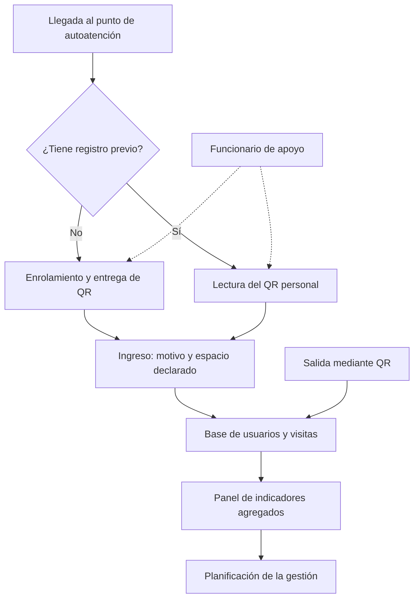

# Sesión — 15 de octubre de 2026

## Desarrollo de la propuesta seleccionada

**Proyecto:** Desafío 01 — Caracterización de usuarios del Hub Providencia.  
**Equipo:** Ingenia 5.

Esta entrada desarrolla Hub Conecta y da continuidad al Estado del Arte, Benchmark y alternativas conceptuales de las sesiones anteriores. La propuesta seleccionada combina QR personal reutilizable, registro de visitas y panel de indicadores.

**Estado del trabajo:** propuesta y planificación del prototipo. Los permisos, plazos y costos definitivos siguen pendientes; no se presentan pruebas como realizadas.

## 1 Problema y necesidad que aborda

### 1.1 Problema específico

El registro actual del Hub Providencia solicita completar un formulario en cada visita, sin reconocer automáticamente a las personas previamente registradas. Esto genera repetición de información y dificulta consolidar las visitas de una misma persona para analizar su recurrencia y utilización de espacios.

La propuesta intervendrá específicamente en la identificación de usuarios recurrentes y la asociación de sus visitas con un perfil único, simplificando el registro y generando información estructurada para la gestión.

### 1.2 Personas afectadas y evidencia

- Personas usuarias recurrentes: deben completar nuevamente información en cada visita.

- Equipo de gestión: necesita consolidar registros para conocer usuarios únicos, frecuencia y patrones de utilización.

- Personal de atención: debe orientar a quienes presentan dificultades durante el registro.

Según el levantamiento consignado en la bitácora del 24 de septiembre de 2026, el Hub utiliza un formulario digital asociado a un QR y almacena sus respuestas en Google Sheets. La bitácora también señala que el procedimiento no reconoce automáticamente a una persona previamente registrada.

Estos antecedentes sustentan la necesidad de mejorar el proceso. El tiempo de registro, la frecuencia de duplicados y la satisfacción de las personas todavía deberán medirse.

## 2 Descripción de la propuesta seleccionada

### 2.1 Nombre de la propuesta

Hub Conecta: registro único de usuarios y visitas.

### 2.2 Descripción breve

Es un sistema que permite realizar un enrolamiento inicial y entregar a cada persona un QR personal reutilizable. En visitas posteriores, la persona presenta su QR ante la cámara del punto de autoatención y registra únicamente información variable, como el motivo de visita y el espacio principal que utilizará. Cada ingreso queda vinculado al mismo perfil.

El sistema también contempla registrar la salida y presentar indicadores agregados al equipo de gestión. Un funcionario estará disponible para orientar y resolver dificultades.

### 2.3 Principal valor respecto de la situación actual

La propuesta permite registrar una vez los datos estables y asociar las visitas posteriores al mismo usuario, reduciendo la repetición. Su aporte consiste en integrar identificación, visitas e indicadores dentro de un proceso sencillo. Así, los registros podrán transformarse en información útil para planificar actividades y analizar la demanda de espacios.

### 2.4 Modelo conceptual

Figura 1. Flujo general de la propuesta. El funcionario apoya el enrolamiento, la lectura y la recuperación del QR.

## 3 Modelo de uso e implementación

### 3.1 Usuarios beneficiarios y responsables

| Actor | Participación |
| --- | --- |
| Personas usuarias | Realizar el enrolamiento y registrar sus ingresos y salidas. |
| Funcionario de apoyo | Orientar el uso, atender dificultades y gestionar recuperaciones de QR. |
| Equipo de gestión | Consultar indicadores y utilizarlos para apoyar decisiones. |
| Ingenia 5 | Diseñar, construir, documentar y evaluar el prototipo. |
| Responsable del Hub | Administrar la operación si se acuerda su continuidad. |

Los beneficiarios son las personas usuarias, por la simplificación esperada del registro, y el equipo de gestión, por disponer de información consolidada.

### 3.2 Secuencia de implementación y uso

1. Definir condiciones: acordar datos mínimos, espacios, responsables y condiciones de prueba.

1. Configurar el prototipo: preparar interfaces, base de datos, QR y panel.

1. Realizar pruebas internas con datos ficticios.

1. Preparar el punto de autoatención y comprobar dispositivo, cámara e instrucciones.

1. Enrolar usuarios y entregar el QR.

1. Registrar visitas posteriores mediante QR, motivo y espacio.

1. Registrar la salida y cerrar la visita correspondiente.

1. Analizar indicadores, errores y experiencia de uso.

1. Ajustar la propuesta y documentar condiciones de continuidad.

### 3.3 Modalidad y alcance

Se propone un piloto controlado, inicialmente en un único punto de autoatención y con un conjunto acotado de espacios. La prueba en el Hub dependerá de su autorización. Mientras tanto, se desarrollarán pruebas internas en condiciones simuladas.

Durante el piloto, el sistema no reemplazará el procedimiento oficial ni funcionará como autorización de acceso al edificio. Una implementación gradual posterior dependerá de los resultados y de los acuerdos con el Hub.

### 3.4 Operación actualización y mantenimiento

Durante el curso, Ingenia 5 realizará el desarrollo, las correcciones y el soporte. El funcionario atenderá dificultades y, mediante acceso autorizado, podrá recuperar identificadores o revisar posibles perfiles duplicados.

Para sostener la propuesta, el Hub deberá designar un responsable de actualizar espacios y categorías, revisar registros incompletos, administrar permisos, ejecutar y comprobar respaldos y coordinar soporte técnico. El equipo entregará instrucciones de instalación, uso, administración y recuperación.

### 3.5 Destinatarios y uso de la información

| Indicador | Definición y utilidad |
| --- | --- |
| Usuarios únicos | Personas distintas con al menos una visita válida durante el período; permite conocer el alcance. |
| Total de visitas | Ingresos válidos, excluyendo duplicaciones y pruebas; permite analizar demanda. |
| Usuarios recurrentes | Personas con dos o más visitas válidas durante el período; permite estudiar recurrencia. |
| Visitas por franja horaria | Ingresos agrupados por horario; apoya la planificación de atención y actividades. |
| Perfil y motivo | Distribución de visitas o usuarios según categorías acordadas, explicitando la unidad contada. |
| Espacio declarado | Visitas asociadas al espacio principal informado al ingresar; explora preferencias. |
| Permanencia promedio | Duración media de visitas con ingreso y salida válidos. |

El equipo de gestión recibirá estos indicadores agregados. El espacio declarado no equivale a ocupación real medida. No se calculará permanencia cuando falte una salida válida.

## 4 Diseño técnico y componentes

### 4.1 Componentes físicos y digitales

| Componente | Implementación y función |
| --- | --- |
| Equipo de autoatención | Computador con cámara disponible para el proyecto; permite enrolamiento y lectura. |
| Aplicación | Aplicación web en Python para gestionar usuarios, visitas y administración. |
| Interfaz pública | Pantallas en navegador para enrolamiento, ingreso y salida. |
| Base de datos | SQLite para relacionar usuarios, visitas y espacios. |
| Identificador QR | Código aleatorio sin datos personales legibles. |
| Panel | Tablas y gráficos dentro de la aplicación con indicadores agregados. |
| Administración | Sección restringida para recuperar QR, revisar registros y actualizar categorías. |
| Respaldo | Copia protegida de la base de datos para recuperación. |

Se propone una arquitectura local. La disponibilidad de equipos está confirmada por el equipo. Antes de las pruebas se verificará cuál se utilizará y su compatibilidad con la lectura del QR.

### 4.2 Relaciones entre componentes

| Entidad | Información principal |
| --- | --- |
| Usuarios | Identificador interno, código QR, nombre, categoría de perfil y fecha de enrolamiento. |
| Visitas | Identificador de visita, usuario asociado, ingreso, salida opcional, motivo y espacio principal declarado. |
| Espacios | Identificador, nombre y estado habilitado para el piloto. |

Una persona podrá tener múltiples visitas. Cada visita estará vinculada a un usuario y a un espacio principal declarado.

Enrolamiento y entrega: la persona completará los datos mínimos en autoatención. El sistema generará su QR y permitirá obtenerlo como imagen. El funcionario apoyará la entrega impresa cuando sea necesaria.

Recuperación y duplicados: la pantalla inicial preguntará si la persona ya está registrada. Si perdió su QR, será derivada al funcionario en lugar de crear inmediatamente otro perfil. La búsqueda y revisión de coincidencias estarán disponibles únicamente en la administración. Los nombres coincidentes requerirán revisión, sin fusión automática por la posible existencia de homónimos.

La recuperación utilizará un procedimiento de verificación acordado con el Hub. Podrá emitirse un nuevo QR e invalidarse el anterior, conservando el historial. En pruebas internas se utilizará un código de control por participante para comprobar que no se creen perfiles adicionales indebidamente.

### 4.3 Requerimientos relevantes

| Requerimiento | Condición y verificación |
| --- | --- |
| Energía | Equipo conectado o con autonomía suficiente para la prueba. |
| Funcionamiento local | Registro y consulta en el mismo computador sin depender de internet. |
| Compatibilidad | Lectura comprobada de QR impresos y en pantalla. |
| Integridad | Identificadores únicos y campos obligatorios validados. |
| Duplicación | Advertencia ante ingreso con una visita abierta. |
| Seguridad | Administración restringida; pantalla pública sin búsqueda ni historial. |
| Privacidad en pantalla | Limpiar los datos al terminar o tras inactividad. |
| Respaldo | Copia consistente y prueba de restauración. |
| Usabilidad | Instrucciones breves, confirmaciones y asistencia. |
| Calidad de datos | Distinguir registros válidos, incompletos, corregidos y de prueba. |

El QR asocia la interacción con un perfil, pero no acredita por sí solo la identidad física de quien lo presenta.

## 5 Prototipo o piloto de Capstone

### 5.1 Parte que se construirá durante la Unidad 3

- Enrolamiento inicial y generación, lectura y recuperación del QR.

- Registro de ingreso, motivo, espacio y salida.

- Administración restringida y panel básico de indicadores.

- Respaldo y documentación.

### 5.2 Aspectos fuera del prototipo

| Exclusión | Justificación |
| --- | --- |
| Sensores y seguimiento automático | Requieren infraestructura y amplían el alcance. |
| Biometría | No es necesaria para comprobar el registro recurrente. |
| Control de acceso | El prototipo registra visitas; no autoriza entradas. |
| Gestión completa de reservas | Proceso adicional que podrá evaluarse posteriormente. |
| Integraciones municipales | Requieren autorización y coordinación técnica. |
| Migración masiva de históricos | Primero deben evaluarse calidad, disponibilidad y permisos. |
| Ocupación interna exacta | Se registran espacios declarados, sin observar desplazamientos. |

### 5.3 Participantes y condiciones de prueba

Primero se realizarán pruebas internas con datos ficticios. Posteriormente, se propone trabajar con 10 a 15 participantes voluntarios, sujeto a autorización y disponibilidad del Hub.

- Un enrolamiento por participante.

- 40 intentos de registro recurrente.

- 20 pruebas de salida correspondientes a visitas abiertas.

- Pruebas específicas de pérdida de QR, lectura repetida, homónimos y campos incompletos.

Los casos deliberadamente erróneos se analizarán por separado de las operaciones normales. Cada prueba tendrá condiciones de inicio definidas para evitar que una visita abierta altere la siguiente. Si no se obtiene autorización, se realizará una simulación controlada, sin presentarla como validación en terreno.

### 5.4 Resultados y criterios de evaluación

| Aspecto | Criterio inicial propuesto |
| --- | --- |
| Asociación correcta | Al menos 38 de 40 intentos recurrentes guardados una sola vez y vinculados al usuario correcto. |
| Integridad | Al menos 38 de 40 intentos con todos los campos obligatorios válidos. |
| Salida | Al menos 19 de 20 pruebas cerradas correctamente. |
| Tiempo | Mediana recurrente inferior a la del procedimiento actual en condiciones comparables. |
| Facilidad de uso | Promedio mínimo 4 de 5, con número y distribución de respuestas. |
| Indicadores | Coincidencia con el cálculo manual. |
| Respaldo | Restauración y comprobación satisfactoria de registros. |
| Errores controlados | Advertir, impedir duplicación o derivar a atención según el caso. |

Se medirá desde el inicio de la interacción hasta la confirmación, procurando que las mismas personas prueben ambos procedimientos. Se distinguirá enrolamiento de ingreso recurrente y se registrará la ayuda recibida. Si no se mide el proceso actual, solo se informará el tiempo del prototipo, sin afirmar una reducción comprobada.

Los errores se contabilizarán aunque se corrijan. Las operaciones repetidas evaluarán funcionamiento; no se interpretarán como una muestra representativa de toda la población del Hub.

## 6 Factibilidad de la propuesta

### 6.1 Metodología de la Unidad 3

| Etapa | Actividades y entregable |
| --- | --- |
| Definición | Confirmar requerimientos, datos, responsables y prueba; requerimientos priorizados. |
| Diseño | Preparar interfaces, datos y atención; diseño técnico y operativo. |
| Construcción | Desarrollar enrolamiento, QR, visitas y panel; prototipo funcional. |
| Verificación interna | Probar errores, permisos y respaldo; registro de pruebas y correcciones. |
| Prueba con participantes | Observar uso, medir tiempos y opiniones; evidencia de evaluación. |
| Ajuste y entrega | Analizar resultados y documentar; prototipo y recomendaciones. |

Las fechas se establecerán cuando la profesora comunique el calendario. La prueba en terreno dependerá de la coordinación con el Hub.

### 6.2 Factibilidad técnica

El equipo cuenta con conocimientos para desarrollar una aplicación en Python y utilizar una base de datos, y dispone de equipos para construir y probar el prototipo. La factibilidad se comprobará mediante un flujo completo: crear un usuario, generar y leer su QR, guardar una visita y visualizarla en el panel. La arquitectura se acota a un equipo; ampliarla a varios puntos simultáneos requerirá evaluación adicional.

### 6.3 Factibilidad económica

Las cifras siguientes son estimaciones académicas de planificación, pendientes de cotización. No representan un presupuesto aprobado ni valores comerciales verificados.

| Concepto del piloto | Supuesto | Monto CLP |
| --- | --- | --- |
| Computador y cámara | Reutilización de equipos | $0 |
| Software | Sin pago previsto; verificar condiciones | $0 |
| Tarjetas QR | Hasta 15 a $500 | $7.500 |
| Señalización e instrucciones | Material impreso | $5.000 |
| Materiales menores | Soportes y útiles | $7.500 |
| Subtotal |  | $20.000 |
| Contingencia | 20 % del subtotal | $4.000 |
| Desembolso estimado |  | $24.000 |

La reutilización implica costo incremental de adquisición de $0; no significa que los equipos carezcan de valor.

| Trabajo estimado | Horas persona |
| --- | --- |
| Análisis y diseño | 10 |
| Construcción | 30 |
| Pruebas y evaluación | 12 |
| Documentación instalación y orientación del piloto | 8 |
| Total | 60 |

Con una tarifa supuesta de $5.000 por hora-persona, solo para valorizar el esfuerzo:

Costo del trabajo = 60 × $5.000 = $300.000 CLP.
Costo económico del piloto = $24.000 + $300.000 = $324.000 CLP.

El trabajo valorizado no implica pago a los integrantes. La instalación inicial está incluida en las 60 horas. Si posteriormente se instala nuevamente y se capacita a otro responsable, se estiman 4 horas adicionales, equivalentes a $20.000 CLP. Este costo no se suma nuevamente al piloto.

| Operación mensual | Supuesto | Monto CLP |
| --- | --- | --- |
| Administración y respaldo | 2 horas a $5.000 | $10.000 |
| Soporte técnico | 2 horas a $5.000 | $10.000 |
| Reposición de materiales | Reserva estimada | $2.000 |
| Total referencial |  | $22.000 |

Se excluyen compra de equipos, energía valorizada y adecuaciones institucionales. Las cifras se ajustarán con cotizaciones, disponibilidad y horas efectivamente utilizadas.

### 6.4 Factibilidad operativa

Se requiere punto de registro, equipo con cámara, funcionario de apoyo, participantes y autorización para la prueba en terreno. Existen recursos para el desarrollo, pero aún no se conocen las condiciones de autorización del Hub. Ante una falla se mantendrá el procedimiento habitual; los registros de contingencia se identificarán para evitar duplicaciones.

### 6.5 Factibilidad social

La propuesta busca simplificar el registro recurrente y mejorar la información de gestión. Las barreras posibles son dificultades digitales, pérdida del QR, problemas de lectura, preocupación por los datos y resistencia al cambio. Se ofrecerán instrucciones breves, QR impreso y asistencia. La aceptación se evaluará mediante observación y encuesta breve sobre claridad, rapidez y confianza; no se considera demostrada previamente.

## 7 Evaluación ética

### 7.1 Aspectos éticos y de responsabilidad

| Aspecto | Medida propuesta |
| --- | --- |
| Privacidad | Recopilar únicamente información necesaria para objetivos acordados. |
| Transparencia | Explicar qué se registra, para qué y quién puede acceder. |
| Participación | Informar el carácter experimental y voluntario. |
| Seguridad | Restringir administración y proteger base y respaldos. |
| Exposición en pantalla | Evitar historiales y datos de otras personas en autoatención. |
| Inclusión | Permitir uso sin teléfono y asistencia. |
| Sesgos | Reconocer limitaciones de participantes voluntarios y muestras pequeñas. |
| Interpretación | Informar datos faltantes; diferenciar declaración de ocupación real. |
| Conservación | Acordar plazo de eliminación o anonimización y responsables antes del piloto. |
| Expectativas | Presentar el sistema como prototipo en evaluación. |

Los datos identificables no se publicarán en GitHub. El repositorio contendrá documentación, código sin credenciales y datos ficticios. Los resultados serán agregados y evitarán identificar participantes.

## 8 Riesgos supuestos y limitaciones

### 8.1 Supuestos para el funcionamiento

- Será posible coordinar las condiciones de prueba.

- Los equipos disponibles superarán las verificaciones técnicas.

- Habrá participantes dispuestos a realizar registros repetidos.

- Un funcionario podrá apoyar una eventual prueba en el Hub.

- La gestión podrá revisar la utilidad de los indicadores.

Estos supuestos se comprobarán antes o durante el piloto.

### 8.2 Fallas posibles

Los riesgos principales se relacionan con identificación, calidad del registro, disponibilidad del equipo, aceptación y continuidad operativa. Sus medidas se detallan en el punto 8.4.

### 8.3 Condiciones fuera del control del equipo

Dependen de terceros la autorización de la prueba en el Hub, disponibilidad de participantes y funcionarios, políticas institucionales, calendario definitivo y recursos para implementación permanente.

### 8.4 Medidas de gestión

| Riesgo | Consecuencia | Medida |
| --- | --- | --- |
| QR perdido o ilegible | No registrar autónomamente | Recuperación asistida y renovación. |
| QR compartido | Asociación con otra persona | Reconocer la limitación y revisar inconsistencias. |
| Perfil duplicado | Historial dividido | Pregunta inicial, recuperación y revisión de coincidencias. |
| Lectura repetida | Ingresos duplicados | Advertir si existe visita abierta. |
| Salida omitida | Permanencia desconocida | Marcar incompleta y excluir del promedio. |
| Falla del equipo | Interrupción | Procedimiento habitual y contingencias documentadas. |
| Pérdida de datos | Registros no recuperables | Respaldo protegido y restauración probada. |
| Baja aceptación | Uso insuficiente o incorrecto | Observar y ajustar interfaz. |
| Espacio mal declarado | Indicador impreciso | Informar alcance sin afirmar ocupación real. |
| Falta de responsable | Discontinuidad | Acordar administración y soporte antes de ampliar. |

El resultado comprometido por Ingenia 5 será un prototipo funcional documentado, evidencia de sus pruebas y una recomendación fundamentada de mejora y continuidad. La validación en terreno se informará únicamente si efectivamente se realiza.

## Cierre y próximos pasos

La actividad permitió concretar la propuesta en un modelo de uso autónomo con apoyo de un funcionario, componentes técnicos, criterios de prueba, presupuesto preliminar y medidas de gestión de riesgos. El siguiente paso será construir y verificar el prototipo, ajustar las estimaciones y coordinar una eventual prueba con el Hub.

## Respaldo documental

Ficha de actividad «Desarrollo de la propuesta seleccionada», Capstone Intermedio, semestre primavera 2026; levantamiento registrado el 24/09/2026; Estado del Arte y Benchmark del 01/10/2026; definiciones confirmadas por el equipo para esta propuesta.

[⬅ Volver al índice](../README.md)
